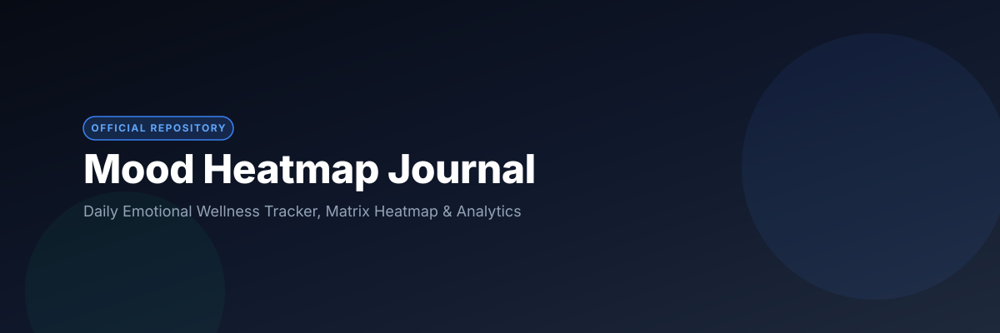
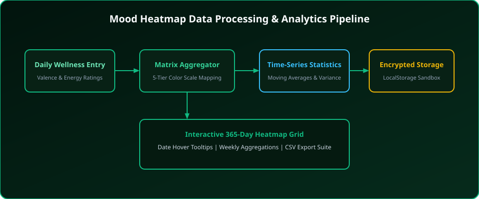
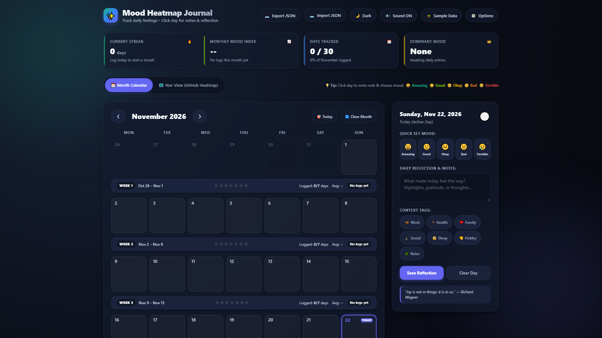

# Mood Heatmap Journal

> Daily Emotional Wellness Tracker, Matrix Heatmap & Analytics

   



## 📌 Executive Overview
A privacy-first emotional wellness analytics journal featuring an interactive GitHub-style annual commit heatmap, multi-dimensional mood vector calculation, and rolling trend statistics.

---

## 🏛 System Architecture
The following diagram highlights the internal computation pipeline, data transformations, and rendering passes:



---

## 📷 Live Application Interface
Below is an authentic 1080p high-resolution capture of the live running interface:



---

## 🔬 Technical Deep-Dive
### Core Technical Specifications
- **Calendar Heatmap Engine:** Renders full 52-week, 365-day SVG commit-style grid with 5 distinct chromatic intensity brackets.
- **Multidimensional Scoring:** Captures valence, energy, sleep duration, and activity tags to construct a unified emotional index.
- **Local Persistence:** Encodes entries locally in the client browser with full offline reliability and zero external tracking.
- **Statistical Export:** Offers JSON backup and CSV structured data export with automated date indexing.

---

## 🚀 Quick Start Guide

### Zero-Dependency Launch
This project is built as a self-contained, high-performance HTML5 application with zero runtime dependencies.

1. **Clone the repository:**
   ```bash
   git clone https://github.com/royalodi/mood-heatmap.git
   cd mood-heatmap
   ```

2. **Launch directly in any modern browser:**
   ```bash
   # Windows (PowerShell)
   Start-Process index.html

   # macOS / Linux
   open index.html || xdg-open index.html
   ```

---

## 📄 License
This project is distributed under the **MIT License**.


---

## 👨‍💻 Author & Lead Maintainer

<table>
  <tr>
    <td align="center" width="150" valign="middle">
      <a href="https://github.com/royalodi">
        
      </a>
      <br /><br />
      <b>Royal Odi</b><br />
      <sub><i>Full-Stack Engineer</i></sub>
    </td>
    <td valign="top">
      <p>
        Designed, engineered, and maintained by <b>Royal Odi</b>. Full-Stack Engineer focused on building scalable web architectures, robust backend systems, and responsive, high-performance digital experiences.
      </p>
      <p>
        <a href="https://github.com/royalodi"></a>
        <a href="mailto:royalodi.dev@gmail.com"></a>
        <a href="https://github.com/royalodi?tab=repositories"></a>
      </p>
    </td>
  </tr>
</table>

